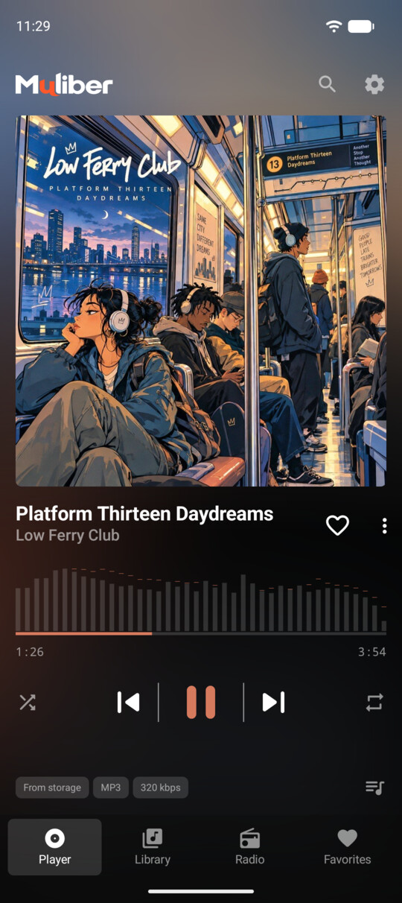
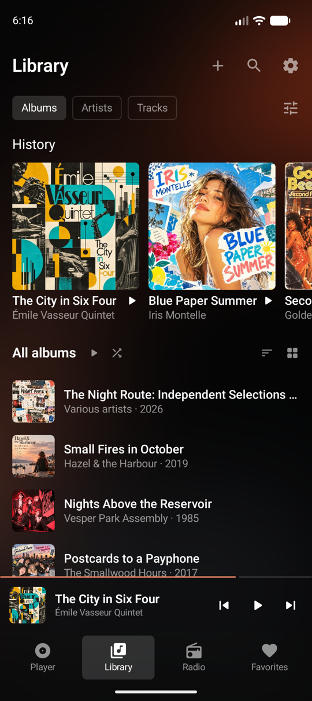
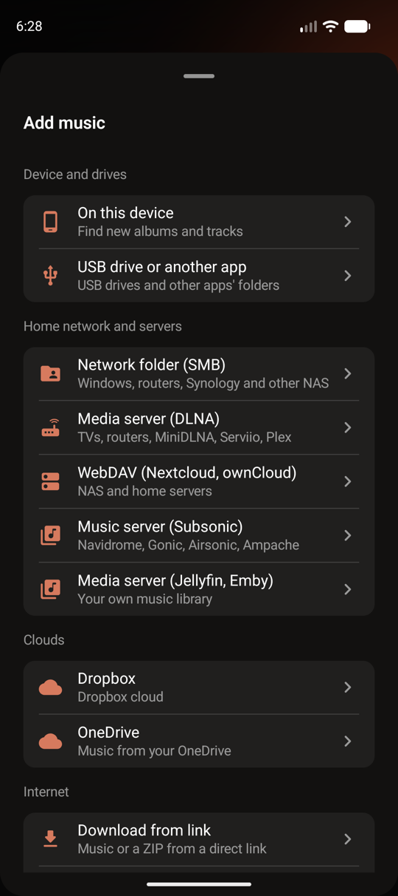
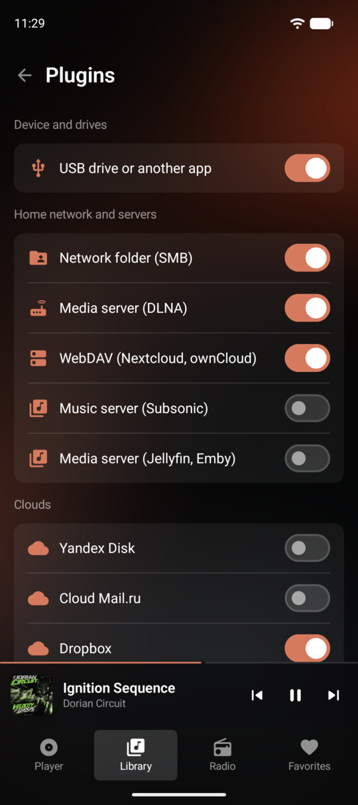

  

  # One player for all your music.

  **Your phone, home server, NAS, cloud storage, and internet radio. One music library.**

  [Website](https://muliber.com/en/) · [Help](https://muliber.com/en/help/) · [Releases](https://github.com/beforsound/muliber/releases) · [Report an issue](https://github.com/beforsound/muliber/issues)

  **Android first · Free · No ads · No account required**

  
  &nbsp;
  
  &nbsp;
  

## Your music, wherever you keep it

Muliber is a music player for the collection you already have. Connect your storage and browse albums, artists, covers, and lyrics in one library. Muliber doesn't offer a commercial music catalog, and you don't need to upload your collection to it.

- **On your device:** music on your phone, SD card, or USB storage.
- **Media servers:** Jellyfin, Emby, Navidrome, other Subsonic-compatible servers, and DLNA.
- **Network storage:** SMB shares, Nextcloud, and WebDAV.
- **Cloud storage:** Dropbox, OneDrive, Cloud Mail.ru, and Yandex Disk. Availability of individual integrations may vary by build.
- **BitTorrent:** your own magnet links and `.torrent` files, plus music from Internet Archive netlabels.
- **Internet radio:** find stations by genre, country, or language, or add a stream by its URL.

[Learn how to connect your music](https://muliber.com/en/help/)

## More than a file list

Muliber organizes music into albums and artist pages using track metadata. It can find covers and lyrics while leaving your original files where they are. When a recording exists in multiple connected sources, Muliber presents it as one track and can use another available copy if a source drops out.

## The first scan takes time

Your music plays right away, with names and covers from the files themselves. In the background, Muliber matches albums against the MusicBrainz catalog and downloads covers. Following MusicBrainz rules, it sends at most one request per second, so a large collection can take several hours, sometimes a day. Speed also depends on your connection and on whether the catalog and cover server respond.

While the spinner next to **Library** turns, there's nothing to fix by hand. If an album still has no exact match or cover afterwards, use **Fix details** or **Change cover** in its menu. [More in Help](https://muliber.com/en/help/library/#first-recognition)

## Listen the way you want

- **Lossless and hi-res playback**, including FLAC.
- **Equalizer, gapless albums, and crossfade.**
- **Offline listening:** playback cache and saved copies of tracks or albums.
- **Internet radio:** favorites, listening history, and current-song information when supplied by the station.
- **Optional integrations:** turn off radio, cloud, server, or BitTorrent features you don't use.

  

## Download and release status

Muliber is under active development and is now in **closed testing on Google Play**. To join:

1. Join the [Muliber testers group](https://groups.google.com/g/muliber-testers) with your Google account.
2. Open the [testing link](https://play.google.com/apps/testing/io.muliber.app) with the same account, tap **Become a tester**, and install Muliber from Google Play.

Muliber requires Android 10 or newer. Please keep the app installed for at least 14 days: Google Play opens the public release only after the closed test runs that long. Feedback is welcome through **Send feedback** on the Muliber page in Google Play or in [issues](https://github.com/beforsound/muliber/issues).

**No public APK has been published in this repository yet.** Once the first public build is ready, it will appear in [GitHub Releases](https://github.com/beforsound/muliber/releases).

## Help and feedback

Found a bug or an unexpected behavior? [Open an issue](https://github.com/beforsound/muliber/issues). Include the app version, Android version, steps to reproduce, and what happened. Remove passwords, tokens, private server addresses, and personal music details from screenshots and logs.

For setup instructions and frequently asked questions, visit [Muliber Help](https://muliber.com/en/help/).

## About this repository

This is the **official public repository for Muliber releases, documentation, and community feedback**. The application source code is maintained separately and is **not open source**. The absence of a license here does not grant permission to copy or redistribute the application or its branding.

Muliber by **BeForSound** · © 2026

[English](https://muliber.com/en/) · [Русский](https://muliber.com/ru/)
